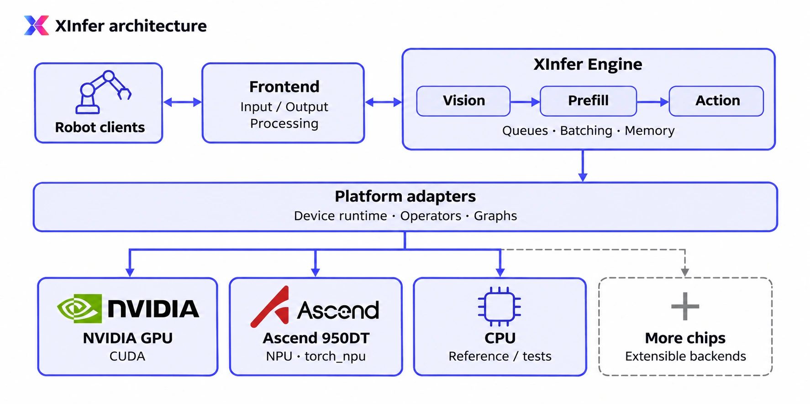

<p align="center">
  
</p>

<h3 align="center">Fast, stable, and accurate VLA inference. From one robot to a fleet.</h3>

<p align="center">
  <b>English</b> | <a href="README.zh-CN.md">简体中文</a>
</p>

<p align="center">
  <a href="#features-at-a-glance">Features</a> ·
  <a href="#quick-start">Quick start</a> ·
  <a href="#models-and-hardware">Models</a> ·
  <a href="docs/benchmark.md">Benchmarks</a> ·
  <a href="#documentation">Documentation</a> ·
  <a href="https://arxiv.org/abs/2611.14969">Paper</a> ·
  <a href="CONTRIBUTING.md">Contributing</a>
</p>

**XInfer is an inference and serving framework for vision-language-action
(VLA) models.** Our goal is fast, stable, and accurate model inference serving
for robots, from onboard inference to shared fleet serving.

The design and its evaluation are described in our paper, [Scaling VLA Serving Under Robotic Execution Constraints](https://arxiv.org/abs/2611.14969).

## Features at a glance

- **Real-time chunking (RTC).** Predict the next action chunk from a new observation while the robot executes the current one.
- **Ultra-low single-robot latency.** Wall-X 2B in BF16 measured 22.3 ms P50 per request on an RTX 5090.
- **Multi-robot serving on one accelerator.** Robots share model weights, and vision encoding can overlap with action generation across requests.
- **Low-precision quantization.** Apply MXFP8 or NVFP4 to selected groups of linear layers.
- **Hardware backends.** NVIDIA RTX 5090, Jetson Thor, Ascend 950DT, and Huixi Rhino RPU (R1) support in development.
- **High-performance kernels.** Use xcompute fused kernels and FlashAttention, or plug in another kernel library.

## Why XInfer

- **Fast.** Low single-request latency and more robots per accelerator.
  Asynchronous stage dispatch, device events, and graph replay where supported
  reduce host overhead. Stage queues and zero-wait batching combine compatible
  queued requests, sharing weights and overlapping work across stages.
- **Stable.** Predictable latency and a service that keeps running under fleet
  load, with warmup before serving, admission limits, and per-request failure
  isolation.
- **Accurate.** Outputs follow the original model. Batch size can affect floating-point rounding. See the [precision guide](docs/precision.md) for the Wall-OSS and Wall-X 2B validation criteria.
- **Extensible.** Reusable layers and stage interfaces
  simplify model integration. Platform and operator adapters connect model
  code to new chips and optimized kernels.

## Quick start

Use Python 3.10+ and a PyTorch build matched to your accelerator. These examples use NVIDIA CUDA. Install from this checkout:

```bash
python -m pip install -e ".[models,serve]"
```

The default Wall-OSS BF16 path uses **xcompute**. Install a build for your CUDA GPU and
check the selected backends in the [kernel guide](docs/kernels.md). If the build is unavailable,
XInfer uses the slower PyTorch reference implementations.

The examples use BF16 and require the [supported Wall-OSS checkpoint layout](docs/models/wall_oss.md#requirements), including its tokenizer and normalization files.
The publicly released Wall-OSS-0.5 and WALL-OSS-FLOW checkpoints use a different layout and do not load directly.

### Serve a model

```bash
xinfer-serve \
  --model wall_oss \
  --checkpoint /path/to/checkpoint \
  --device cuda \
  --warmup observation.msgpack \
  --port 33985
```

`observation.msgpack` is one representative request in the
[model's input format](docs/models/wall_oss.md#run). Warmup runs before the
server accepts connections. For RTC traffic, include both a standard request and
an RTC request in `--warmup`.

Connect at `ws://127.0.0.1:33985` using WebSocket + msgpack. See the
[serving guide](docs/serving.md) for the protocol, health endpoint, and
deployment options.

### Run in Python

```python
from pathlib import Path

from xinfer import Policy
from xinfer.frontend.protocol import unpackb

observation = unpackb(Path("observation.msgpack").read_bytes())
policy = Policy("wall_oss", "/path/to/checkpoint", device="cuda")

try:
    policy.warmup([observation])
    response = policy.infer(observation)
finally:
    policy.engine.shutdown()
```

The response contains the model's action chunk. Camera names, state fields,
and action representations are documented in each model guide.

## Models and hardware

| Model | Model ID | Precision | Real-time chunking | Guide |
|---|---|---|---|---|
| Wall-OSS · internal checkpoints | `wall_oss` | BF16 (xcompute; reference operators) | Supported | [Setup and inputs](docs/models/wall_oss.md) |
| Wall-X 2B | `wallx2b` | BF16; optional MXFP8 for vision and prefill (action stays BF16) | Supported | [Setup and inputs](docs/models/wallx2b.md) |

Wall-X 2B requires a compatible checkpoint supplied separately. See the [Wall-X 2B guide](docs/models/wallx2b.md) for the serving command and desktop robot request format. The [performance table](docs/performance.md) compares single-request latency, robot capacity and throughput for both models on an RTX 5090 and on an Ascend 950DT; the [Ascend guide](docs/ascend950dt.md#wall-x-2b-operator-list) lists which operators each model runs there.

| Hardware | Device | Runtime |
|---|---|---|
| NVIDIA GPUs · RTX 5090 (SM120) | `cuda` | PyTorch + CUDA |
| NVIDIA Jetson Thor (SM110) | `cuda` | PyTorch + CUDA, optional Wall-OSS xcompute kernels |
| Huawei Ascend 950DT NPU | `npu` | PyTorch + `torch_npu` + CANN |
| CPU | `cpu` | Reference implementations and tests |

Each accelerator runs its own Engine and weights.

Optimized CUDA execution uses an **xcompute** build and the optional FlashAttention
backend; see [kernels](docs/kernels.md).
Ascend binds a prebuilt Ascend **xcompute** build the same way, with NPU graphs and
DVPP device images; see the [Ascend guide](docs/ascend950dt.md).

## Performance

Single-request latency and capacity of each serving configuration, measured with `benchmarks/performance.py`
([conditions](docs/performance.md)):

| # | Model | Precision, composition | Accelerator | Single request P50 | Robots per accelerator | Server P50 at capacity | Server P95 at capacity | Peak throughput |
|---|---|---|---|---|---|---|---|---|
| 1 | Wall-OSS | BF16, optimized | RTX 5090 | 49.0 ms | 4 | 128 ms | 142 ms | 25.6 req/s |
| 2 | Wall-X 2B | BF16, optimized | RTX 5090 | 22.3 ms | 14 | 85 ms | 107 ms | 81.3 req/s |
| 3 | Wall-OSS | BF16, optimized | Ascend 950DT | 80.8 ms | 2 | 120 ms | 128 ms | 16.1 req/s |
| 4 | Wall-X 2B | BF16, optimized | Ascend 950DT | 79.7 ms | ≥ 2 | 87 ms | 93 ms | 11.2 req/s |

## How it works

<p align="center">
  
</p>

The Frontend handles input and output processing. Models define stage
computation and tensor handoffs; the Engine manages admission, queues,
batching, and resource lifetimes. Platform adapters provide device execution,
while operator backends supply optimized kernels. The Python API and network
service share the same Engine and configuration rules. See the
[Engine guide](docs/engine.md) for the execution model and
[configuration](docs/configuration.md) for defaults and overrides.

## Benchmarks

Evaluate single-request latency and the number of robots served within a
defined response-latency target:

| Tool | Measures |
|---|---|
| [Single-request latency](benchmarks/request_latency.py) | Input processing, Engine execution, output processing, and total time in process |
| [Robot load](benchmarks/robot_load.py) | Client and server latency, throughput, errors, and action-queue underflow under concurrent robot traffic |
| [Performance table runner](benchmarks/performance.py) | Single-request latency and robot capacity for one serving configuration |

For commands and measurement definitions, see the [benchmark guide](docs/benchmark.md). For stage timings and numerical checks, see the [Wall-OSS validation](docs/models/wall_oss_validation.md) and [Wall-X 2B validation](docs/models/wallx2b_validation.md).

## Documentation

| Topic | Start here |
|---|---|
| Deploy a service | [Serving](docs/serving.md) |
| Understand scheduling and CUDA graphs | [Engine](docs/engine.md) |
| Configure a deployment | [Configuration](docs/configuration.md) |
| Build and enable the optimized kernels | [Kernels](docs/kernels.md) |
| Select numerical formats | [Quantization](docs/quantization.md) |
| Validate model outputs | [Precision](docs/precision.md) |
| Profile operators | [Profiling](docs/profiling.md) |
| Monitor a service with Prometheus and Grafana | [Metrics](docs/metrics.md) |
| Extend the framework | [Model interface](xinfer/models/interface.py) · [Architecture and design](docs/design.md) |

## Citation

If you use XInfer in your research, please cite our paper:

```bibtex
@misc{zhang2026scalingvlaservingrobotic,
      title={Scaling VLA Serving Under Robotic Execution Constraints},
      author={Yue Zhang and Zicong Ye and Lufang Chen and Dance Yang and Mingyang Li and Zhenwei Duan and Michael Zhao and Ziye Deng and Starrick Liu and Ruizhi Chengze and YongHua Chen and SongAo Han and Yu Sun and Ran Yu and Xiaofan Li and Ruyi Gan and Hao Wang},
      year={2026},
      eprint={2611.14969},
      archivePrefix={arXiv},
      primaryClass={cs.RO},
      url={https://arxiv.org/abs/2611.14969},
}
```

## Contributing

See [CONTRIBUTING.md](CONTRIBUTING.md) for code conventions, tests, and
performance evidence requirements.

---

This distribution does not currently include a license.
