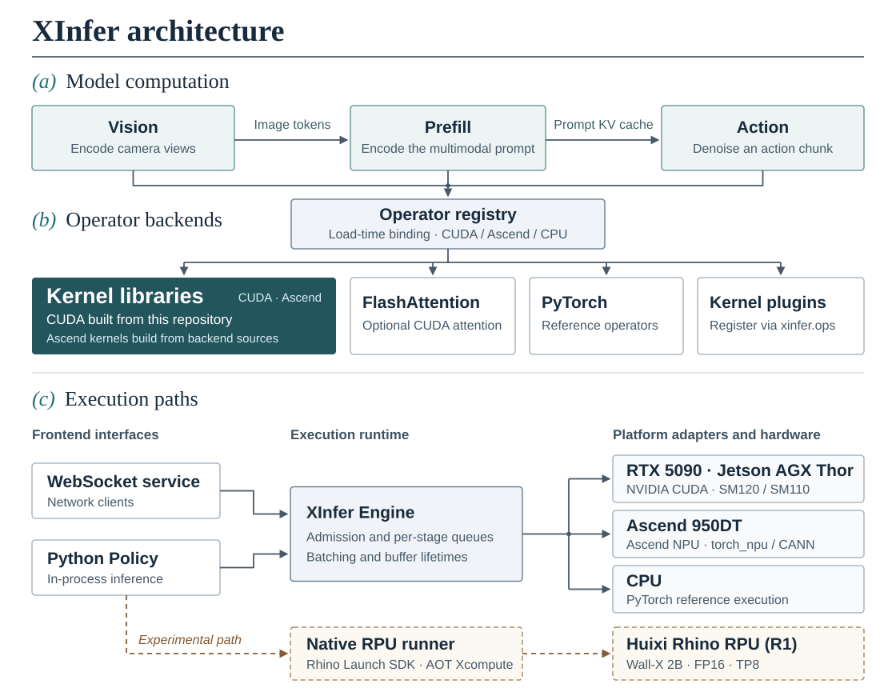

<p align="center">
  
</p>

<h3 align="center">快速、稳定、准确的 VLA 推理，从单台机器人到整个机队。</h3>

<p align="center">
  <a href="README.md">English</a> | <b>简体中文</b>
</p>

<p align="center">
  <a href="#特性一览">特性</a> ·
  <a href="#快速开始">快速开始</a> ·
  <a href="#模型与硬件">模型</a> ·
  <a href="docs/benchmark.zh-CN.md">基准测试</a> ·
  <a href="#文档">文档</a> ·
  <a href="https://arxiv.org/abs/2611.14969">论文</a> ·
  <a href="CONTRIBUTING.md">参与贡献</a>
</p>

**XInfer 是面向视觉-语言-动作（VLA）模型的推理与服务框架。** 我们的目标是为机器人提供快速、稳定、准确的模型推理服务，覆盖从机载推理到机队共享服务的各种场景。

XInfer 的设计与评测见我们的论文 [Scaling VLA Serving Under Robotic Execution Constraints](https://arxiv.org/abs/2611.14969)。

## 特性一览

- **实时分块（RTC）**　机器人执行当前动作段时，即可根据新观测预测下一段。
- **单机器人极低时延**　Wall-X 2B BF16 在 RTX 5090 上的单请求 P50 为 22.3 ms。
- **单卡服务多机器人**　多台机器人共享模型权重，不同请求的视觉编码与动作生成可重叠执行。
- **低精度量化**　支持按层组对线性层使用 MXFP8 或 NVFP4。
- **多硬件后端**　NVIDIA RTX 5090、Jetson Thor、昇腾 950DT、Huixi Rhino RPU（R1，适配中）。
- **高性能算子库**　使用 Xcompute 融合算子，支持 FlashAttention，也可接入其他算子库。

## 为什么选择 XInfer

- **快速。** 单请求时延低，每个加速器能服务更多机器人。异步阶段发射、设备事件以及（在支持的平台上）图回放降低了主机开销。阶段队列和零等待组批把排队中的兼容请求合并执行，共享权重，并让不同阶段的工作相互重叠。
- **稳定。** 时延可预测，服务在机队负载下持续运行：服务前先预热，有准入限制，并对逐请求的故障进行隔离。
- **准确。** 输出忠实于原始模型。不同批大小可能带来浮点舍入差异。Wall-OSS 和 Wall-X 2B 的验证标准见[精度门禁](docs/precision.zh-CN.md)。
- **可扩展。** 可复用的层和阶段接口简化了模型接入。平台适配器和算子适配器把模型代码接到新芯片和优化过的 kernel 上。

## 快速开始

使用 Python 3.10+ 和与加速器匹配的 PyTorch 版本。下面的示例使用 NVIDIA CUDA。在当前检出的仓库中安装：

```bash
python -m pip install -e ".[models,serve]"
```

Wall-OSS 默认的 BF16 优化路径使用本仓库中的 CUDA kernel。针对所用 GPU 编译后，按 [kernel 指南](docs/kernels.zh-CN.md)检查各算子的后端。没有编译这个库时使用较慢的 PyTorch 实现。

以下示例使用 BF16，需要[受支持的 Wall-OSS checkpoint 布局](docs/models/wall_oss.zh-CN.md#环境要求)，包括 tokenizer 和归一化文件。公开的 Wall-OSS-0.5 和 WALL-OSS-FLOW 权重布局不同，目前无法直接加载。

### 启动模型服务

```bash
xinfer-serve \
  --model wall_oss \
  --checkpoint /path/to/checkpoint \
  --device cuda \
  --warmup observation.msgpack \
  --port 33985
```

`observation.msgpack` 是一个符合[模型输入格式](docs/models/wall_oss.zh-CN.md#运行)的代表性请求。预热在服务开始接受连接之前运行。如有 RTC 流量，请在 `--warmup` 中同时提供一个普通请求和一个 RTC 请求。

通过 WebSocket + msgpack 连接 `ws://127.0.0.1:33985`。协议、健康检查端点和部署选项见[服务指南](docs/serving.zh-CN.md)。

### 在 Python 中运行

```python
from pathlib import Path

from xinfer import Policy
from xinfer.frontend.protocol import unpackb

observation = unpackb(Path("observation.msgpack").read_bytes())
policy = Policy("wall_oss", "/path/to/checkpoint", device="cuda")

try:
    policy.warmup([observation])
    response = policy.infer(observation)
finally:
    policy.engine.shutdown()
```

响应中包含模型输出的动作块（action chunk）。相机名称、状态字段和动作表示见各模型的指南。

## 模型与硬件

| 模型 | 模型 ID | 精度 | 实时分块（real-time chunking） | 指南 |
|---|---|---|---|---|
| Wall-OSS · 内部 checkpoint | `wall_oss` | BF16（Xcompute；参考算子） | 支持 | [安装与输入](docs/models/wall_oss.zh-CN.md) |
| Wall-X 2B | `wallx2b` | BF16；视觉和预填充可选 MXFP8 或 NVFP4，动作阶段保留 BF16 | 支持 | [安装与输入](docs/models/wallx2b.zh-CN.md) |

Wall-X 2B 需要自备兼容的 checkpoint，部署命令和请求格式见 [Wall-X 2B 指南](docs/models/wallx2b.zh-CN.md)。两款模型在 RTX 5090 上的单请求时延、单卡机器人数和吞吐量见[性能表](docs/performance.zh-CN.md)；昇腾 950DT 上的数据在同一张表内，各模型在该平台承接的算子见[昇腾指南](docs/ascend950dt.zh-CN.md)。

| 硬件 | 设备 | 运行时 |
|---|---|---|
| NVIDIA GPU · RTX 5090 (SM120) | `cuda` | PyTorch + CUDA |
| NVIDIA Jetson Thor (SM110) | `cuda` | PyTorch + CUDA |
| Huawei Ascend 950DT NPU | `npu` | PyTorch + `torch_npu` + CANN |
| Rhino RPU (R1) | `rpu` | Rhino Launch SDK AOT · [配置](docs/models/wallx2b_rpu.zh-CN.md) |
| CPU | `cpu` | 参考实现与测试 |

每个加速器运行各自的引擎（Engine）和权重。

优化的 CUDA 执行路径使用由本仓库编译的 kernel 库和可选的 FlashAttention 后端；见 [kernel](docs/kernels.zh-CN.md)。Ascend 绑定预构建的昇腾 **xcompute** 构建，支持 NPU 图和 DVPP 设备图像；见[昇腾指南](docs/ascend950dt.zh-CN.md)。

## 性能

以下为使用 `benchmarks/performance.py` 测得的单加速器结果。测量条件和复现进度见[性能指南](docs/performance.zh-CN.md)。

| 模型 | 精度与阶段 | 加速器 | 单请求 P50 | 单卡机器人数 | 容量点服务端 P50 / P95 | 峰值吞吐 |
|---|---|---|---|---|---|---|
| Wall-X 2B | BF16 | RTX 5090 | 22.3 ms | 14 | 85 / 107 ms | 81.3 req/s |
| Wall-X 2B | 视觉和预填充 MXFP8 | RTX 5090 | 15.1 ms | 25 | 67 / 88 ms | 141.0 req/s |
| Wall-X 2B | BF16 | 昇腾 950DT | 20.6 ms | 15 | 129 / 163 ms | 83.9 req/s |
| Wall-OSS | BF16 | RTX 5090 | 49.0 ms | 4 | 128 / 142 ms | 25.6 req/s |
| Wall-OSS | BF16 | 昇腾 950DT | 38.8 ms | 5 | 122 / 139 ms | 33.2 req/s |
| Wall-OSS | BF16 | Jetson AGX Thor | 95.4 ms | 2 | 123 / 141 ms | 11.5 req/s |

MXFP8 量化视觉和预填充阶段的部分线性层。动作阶段保留 BF16。

- **RTX 5090 上的 NVFP4。** 已提供预设。仓内优化算子见 [PR #28](https://github.com/X-Square-Robot/xinfer/pull/28)。通过精度验证后再补充性能数据（**TBD**）。
- **昇腾 950DT。** 现有后端使用预构建的 Xcompute 库。仓内算子见 [PR #33](https://github.com/X-Square-Robot/xinfer/pull/33)。这组昇腾 950DT 测量的公开构建产物和复现步骤待补充（**TBD**）。

## 工作原理

<p align="center">
  
</p>

前端（Frontend）负责输入处理和输出处理。模型定义各阶段的计算和张量交接；引擎管理准入、队列、组批和资源生命周期。加载模型时，算子注册表为目标设备上的每个算子选择实现。X-Square Robot 自研的 **Xcompute** 提供 QKV 投影与 RoPE、残差加法与 RMSNorm 等融合算子。同一注册表也支持 CUDA 上可选的 FlashAttention、PyTorch 参考算子和第三方算子库。平台适配器负责设备执行。在 CUDA、昇腾和 CPU 上，Python API 与网络服务共用同一引擎。虚线表示正在适配的 Huixi R1 路径，Wall-X 2B 通过进程内 Python 接口调用 Rhino Launch SDK。执行模型见[引擎指南](docs/engine.zh-CN.md)，默认值与覆盖方式见[配置](docs/configuration.zh-CN.md)。

## 基准测试

评估单请求时延，以及在给定响应时延目标内能服务的机器人数：

| 工具 | 测量内容 |
|---|---|
| [单请求时延](benchmarks/request_latency.py) | 进程内的输入处理、引擎执行、输出处理耗时及总耗时 |
| [机器人负载](benchmarks/robot_load.py) | 多台机器人并发流量下的客户端与服务端时延、吞吐、错误及动作队列下溢（underflow） |
| [性能表测量脚本](benchmarks/performance.py) | 同一服务配置的单请求时延和单卡机器人数 |

命令和测量口径见[基准测试指南](docs/benchmark.zh-CN.md)。各阶段耗时和精度结果见 [Wall-OSS 验证](docs/models/wall_oss_validation.zh-CN.md)和 [Wall-X 2B 验证](docs/models/wallx2b_validation.zh-CN.md)。

## 文档

| 主题 | 从这里开始 |
|---|---|
| 部署服务 | [服务](docs/serving.zh-CN.md) |
| 了解调度与 CUDA graph | [引擎](docs/engine.zh-CN.md) |
| 配置部署 | [配置](docs/configuration.zh-CN.md) |
| 编译并启用优化 kernel | [Kernel](docs/kernels.zh-CN.md) |
| 选择数值格式 | [量化](docs/quantization.zh-CN.md) |
| 验证模型输出 | [精度](docs/precision.zh-CN.md) |
| 分析算子性能 | [性能剖析](docs/profiling.zh-CN.md) |
| 用 Prometheus 和 Grafana 监控服务 | [指标](docs/metrics.zh-CN.md) |
| 扩展框架 | [模型接口](xinfer/models/interface.py) · [架构与设计](docs/design.zh-CN.md) |

## 引用

如果你在研究中使用了 XInfer，请引用我们的论文：

```bibtex
@misc{zhang2026scalingvlaservingrobotic,
      title={Scaling VLA Serving Under Robotic Execution Constraints},
      author={Yue Zhang and Zicong Ye and Lufang Chen and Dance Yang and Mingyang Li and Zhenwei Duan and Michael Zhao and Ziye Deng and Starrick Liu and Ruizhi Chengze and YongHua Chen and SongAo Han and Yu Sun and Ran Yu and Xiaofan Li and Ruyi Gan and Hao Wang},
      year={2026},
      eprint={2611.14969},
      archivePrefix={arXiv},
      primaryClass={cs.RO},
      url={https://arxiv.org/abs/2611.14969},
}
```

## 参与贡献

代码规范、测试和性能证据要求见 [CONTRIBUTING.md](CONTRIBUTING.md)。

---

此发行版尚未附带许可证。
